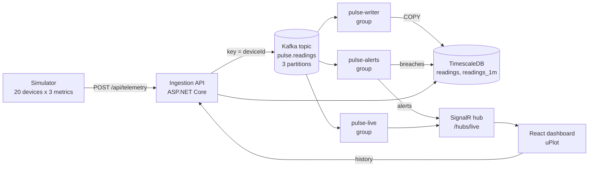
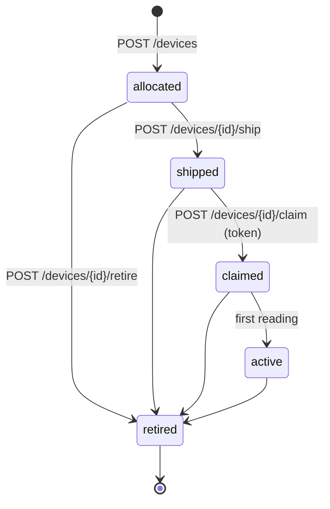

# Pulse

[](https://github.com/sskobalskyi/pulse/actions/workflows/ci.yml)

Real-time device telemetry platform. A simulator emits readings, an ingestion API publishes them to Kafka, independent stream processors persist them to TimescaleDB, evaluate alert rules and push live updates to a React dashboard over SignalR.


## What it demonstrates

- **Event streaming:** Kafka (Redpanda) topic keyed by device id, so one device always maps to one partition and keeps its ordering.
- **Consumer groups:** three independent groups (`pulse-writer`, `pulse-live`, `pulse-alerts`) read the same topic. Offsets are committed after a batch is handled (at-least-once delivery), batches are written with one idempotent `INSERT ... ON CONFLICT DO NOTHING`.
- **Alerting with hysteresis:** threshold rules have a margin. A breach raises one alert, and a second "resolved" alert is recorded only when the value comes back past the margin, so a value hovering around a threshold does not flap. State is rebuilt from the database on restart.
- **No-data alerts:** a sensor that stops reporting raises a "no data for 60s" alert and resolves it when data resumes. A silent device sends nothing, so no Kafka consumer can notice it. The writer upserts `device_last_seen` (by server receive time) and a `SilenceMonitor` polls it on a timer. The device list is built from the same table, so a silent series stays on the dashboard, flagged "no data" with its last known value, instead of disappearing after 10 minutes. With several API instances only the one holding a Postgres advisory lock evaluates in each round.
- **Time-series modelling:** TimescaleDB hypertable, a 1-minute continuous aggregate, a 7-day retention policy on raw data. Short chart windows read raw rows, longer ones read the aggregate.
- **Real-time push:** SignalR hub with a throttled client store (state lives in refs and is published to React at most every 250 ms).
- **Observability:** OpenTelemetry traces across HTTP and Kafka (context in message headers, span links for batches), metrics including per-partition consumer lag, and correlated logs. See [Observability](#observability).
- **Channels:** a series is a device, a metric and a channel, so one device can have several sensors of the same kind (a soil moisture sensor per zone). Alerts, no-data detection and charts work per channel. Readings of known metrics are checked against a plausible range, and a registered device's readings must fit the channels it declared. See [Channels and metrics](#channels-and-metrics).
- **Device registry:** devices are registered before they send data and move through `allocated`, `shipped`, `claimed`, `active`, `retired`. Claiming uses a one-time, expiring token that is stored only as a hash and is rate limited. Retiring a device stops its no-data alerts. See [Device registry and authentication](#device-registry-and-authentication).
- **Alert rules per device:** each channel of a device can have a threshold rule (range and hysteresis margin) and a no-data timeout of its own, set over the API. A channel without one uses the platform's rules for its metric. See [Alert rules](#alert-rules).
- **Integration events:** alerts, device status and retirements are published to RabbitMQ through a transactional outbox, and devices are registered from `device.allocated.v1`. Off by default. See [Integration events](#integration-events).
- **Authentication:** Keycloak JWTs behind a switch. Service callers manage the registry, users see only the devices they own.
- **Schema migrations:** plain SQL files applied by the API on startup, with an existing database adopted rather than rebuilt ([ADR 0002](docs/adr/0002-sql-migrations-on-startup.md)).
- **Contract tests:** responses are validated against `contracts/pulse-device-api.yaml`, the OpenAPI document that the rest of the system is built against.
- **i18n:** `en` (default) and `uk`, react-i18next with browser language detection.
- **Tests:** xUnit for the alert rules and tracker, Testcontainers tests for the database layer and for the whole backend pipeline (HTTP ingest, Kafka, stream processors, TimescaleDB and SignalR in one process against real containers), and Playwright E2E for the dashboard in both locales.

## Architecture



The processors run as `BackgroundService`s inside the API process to keep the demo small. Because each is its own consumer group, any of them can be moved into a separate service without touching the others (see [ADR 0001](docs/adr/0001-kafka-consumer-groups-in-process.md)).

## Run it

Requirements: Docker. Everything runs locally.

```bash
docker compose up --build
```

- Dashboard: http://localhost:8080
- API: http://localhost:5080 (`GET /health`, `GET /api/devices` (every series that ever reported, with its latest value and a `silent` flag), `GET /api/alerts`, `GET /api/devices/{id}/series?metric=temperature&minutes=5`, `POST /api/telemetry`)
- Device registry: `http://localhost:5080/api/pulse/v2/devices` and below, see [below](#device-registry-and-authentication)

### Development

```bash
docker compose up -d redpanda timescaledb     # infrastructure only
dotnet run --project src/Pulse.Api --urls http://localhost:5080
dotnet run --project src/Pulse.Simulator
cd web && npm install && npm run dev          # http://localhost:5173
```

The schema script only runs on an empty database volume. After pulling schema changes, reset it with `docker compose down -v`.

### Tests

```bash
dotnet test                                    # unit, database and pipeline tests (the last two need Docker)
cd web && npx playwright install chromium     # once
cd web && npm test                               # frontend unit tests (live state handling)
cd web && npx playwright test                  # E2E, needs the stack running (PULSE_WEB_URL overrides the URL)
docker compose --profile loadtest run --rm k6  # load smoke test, needs the stack running
```

### Load smoke test

[`k6/smoke.js`](k6/smoke.js) runs for 30 seconds against the running stack: 20 requests per second of 50 readings each (1,000 readings per second) while a second scenario reads `/api/devices` and a series like a dashboard would. It is a regression gate that fits in CI, not a benchmark. The run fails (exit code 99) unless:

- fewer than 1% of requests fail, and 99% of checks pass
- p95 of ingestion is under 500 ms, and p95 of the read endpoints under 1 s
- no iteration is dropped, meaning the arrival rate was actually reached
- **every test device shows up in `/api/devices` after the run**. The API answers 202 as soon as Kafka has the message, so a broken consumer or database would not show in request latency. With TimescaleDB stopped the ingestion checks still pass and only this one fails (0 of 20 devices delivered).

Typical local result: ingest p95 about 12 ms, devices p95 about 40 ms, 20 of 20 devices delivered. The rates can be changed per run, for example `docker compose --profile loadtest run --rm -e INGEST_RATE=100 -e DURATION=60s k6`. Use `--no-deps` when the stack is already up, otherwise compose starts its dependencies too.

## Device registry and authentication

The registry follows [`contracts/pulse-device-api.yaml`](contracts/pulse-device-api.yaml) and lives under `/api/pulse/v2`.
Pulse stays generic: it knows devices, channels and owners, not what they are used for.



| Operation | Who | Notes |
| --- | --- | --- |
| `POST /devices` | service | Registers a device with its capability manifest. Repeating it changes nothing and returns 200. |
| `POST /devices/{id}/ship` | service | Makes it claimable. Repeating it is accepted. |
| `POST /devices/{id}/claim` | service | Binds it to `ownerId`. Needs the one-time token, which works once and expires. At most 5 attempts a minute per device and 30 per caller, then 429 with `Retry-After`. |
| `POST /devices/{id}/retire` | service | Stops its no-data alerts, erases an unused token, refuses its telemetry (409). |
| `GET /devices`, `GET /devices/{id}` | user or service | A user sees only their own devices. A device that is not theirs answers 404. |
| `PUT /devices/{id}/channels/{channelId}/calibration` | user or service | Stores the dry and wet raw values of a channel. They are stored, not yet applied to readings. |
| `GET /devices/{id}/channels/{channelId}/series` | user or service | Points of one channel, see [Channels and metrics](#channels-and-metrics). |
| `GET /devices/{id}/rules` | user or service | The alert rules of a device. A user reads the rules of their own devices. |
| `PUT /devices/{id}/rules` | service | Replaces them, see [Alert rules](#alert-rules). A user cannot set rules even on their own device. |

Errors are `application/problem+json` with a stable `code` (`invalid_state`, `token_invalid`, `token_expired`, `rate_limited`,
`validation_failed`, ...) to switch on. Commands from the same contract are not implemented yet.

### Channels and metrics

A device declares its **channels** when it is registered: each has an id and a metric. A reading names its channel, and
everything downstream (storage, the 1-minute aggregate, alerts, no-data detection, charts) is keyed by device and channel.

```json
{ "deviceId": "ghx-0001", "channel": "soil-2", "metric": "soil_moisture", "value": 47.5, "timestamp": "2026-10-21T12:00:00Z" }
```

- A reading that names no channel is on the channel called after its metric. That keeps the demo simulator, and any sender that
  never heard of channels, working unchanged, and it is what a device with one sensor per metric can rely on.
- For a **registered** device the reading has to fit what it declared. Without a channel it goes to the only channel of its metric;
  if there are two soil moisture channels it must say which (`ambiguous_channel`). A channel the device does not have is
  `unknown_channel`, and a channel used for another metric is `metric_mismatch`. One bad reading refuses the whole batch, and none of it is stored.
- A device nobody registered declared nothing, so its readings are accepted as they come.

Readings of the platform's metrics are checked against the range a real sensor can produce. A pH of 70 or a soil moisture of
4095 is a faulty sensor or a unit mix-up, and is refused with `value_out_of_range` instead of poisoning charts and alerts.
Metrics outside the list (the demo's `humidity` and `battery`) are not judged.

| Metric | Unit | Range |
| --- | --- | --- |
| `temperature` | °C | -55 to 125 |
| `air_humidity`, `soil_moisture`, `tank_level` | % | 0 to 100 |
| `ph` | pH | 0 to 14 |
| `light` | lx | 0 to 200 000 |
| `airflow` | m/s | 0 to 60 |
| `flow` | L/min | 0 to 100 |
| `overflow` | flag | 0 or 1 |

**Series.** `GET /api/pulse/v2/devices/{id}/channels/{channel}/series?from=...&to=...&resolution=raw|1m|1h` returns points in ascending time.
`from` is required and `to` defaults to now. Each resolution has a longest window, so one request cannot ask for millions of points:

| Resolution | Source | Longest window | Point |
| --- | --- | --- | --- |
| `raw` (default) | the readings | 6 hours, at most 10 000 points | `ts`, `value` |
| `1m` | the 1-minute aggregate | 7 days | `ts`, `value` (average), `min`, `max` |
| `1h` | the 1-minute aggregate | 365 days | `ts`, `value` (average weighted by readings per minute), `min`, `max` |

A raw series that hit the point limit carries the latest points and the header `X-Pulse-Truncated: true`. A user sees the
series of their own devices only, like everything else.

### Alert rules

A device's rules say what is normal for each of its channels. They are stored with the device and replaced as a whole:
`PUT /devices/{id}/rules` with a list, where an empty list removes every rule of its own and puts the device back on the platform defaults.

```json
[
  { "channelId": "soil-1", "kind": "threshold", "min": 40, "max": 70, "margin": 5 },
  { "channelId": "soil-1", "kind": "no_data",   "timeoutSeconds": 900 },
  { "channelId": "air-t",  "kind": "threshold", "max": 32 }
]
```

- **Threshold.** At least one of `min` and `max`. `margin` is how far back inside the range a value has to come before the alert clears
  (hysteresis, default 0). With both bounds it must be less than half the range, or the alert could never clear.
- **No data.** How long the channel may stay quiet, from 10 seconds to a week.
- A channel has at most one rule of each kind, and only for channels the device declared (`unknown_channel` otherwise). The whole list is validated
  first and nothing changes if any rule is wrong.
- A channel **with** a threshold rule uses only that. A channel **without** one uses the platform's rules for its metric
  (`Alerts:Rules`, `Alerts:NoData:Timeout`). So a soil moisture channel has no alert at all until it is given a rule.
- Rules apply to the very next reading. Changing or removing a rule resolves the alert that was raised under the old one, instead of leaving it raised
  for ever. An alert belongs to a rule by name, and the name carries the range, so a changed range is a different rule. The same happens after
  a restart, because the state is restored from storage.
- Only a service caller sets rules. Greenhaus turns a pot's requirements into them, and letting anyone write them straight to Pulse would bypass what a tier may have.

### Integration events

Other systems learn what happens in Pulse through events on RabbitMQ, as [`contracts/integration-events.yaml`](contracts/integration-events.yaml) defines
them. They are off by default, so Pulse runs alone without a broker. To turn them on with a local RabbitMQ:

```bash
docker compose -f docker-compose.yml -f docker-compose.events.yml up --build
```

(management UI on http://localhost:15673, user and password `pulse`). Every event goes to the topic exchange `integration.events`
with its name as the routing key, a persistent message, and the headers the contract asks for: `messageId`, `occurredAt`, `schemaVersion` and
`traceparent`. A queue that wants a family of events binds with `#`, for example `alert.#`, because `*` matches only one word of the three in `alert.raised.v1`.

| Event | Published when | Notes |
| --- | --- | --- |
| `alert.raised.v1`, `alert.resolved.v1` | an alert changes state | One `alertId` for the raised and the resolved event of the same alert. `direction` (below or above) only on raised. A no-data alert has no `value`. |
| `device.status.v1` | a device goes offline or comes back | Online while any channel reports within its no-data timeout, offline when all are quiet. Cause `no_data` or `reconnect`. `last_will` comes with the MQTT bridge. A device that never reports is not announced. |
| `device.retired.v1` | a device is retired | Once, not again on a repeated retire. |
| `device.allocated.v1` (consumed) | | Registers the device. Receiving it twice changes nothing. |

**Outbox.** An event is written to the `outbox` table in the same transaction as the change it describes, and a background relay publishes it afterwards. Publishing after the commit
would lose an event if the process died in between, and publishing before would announce something that then fails to commit. A change that is stored again (a redelivered Kafka batch)
is not announced again. Delivery is **at least once**: if Pulse dies after the broker took a message but before the row was marked, the message goes out again with the same `messageId`,
so consumers deduplicate on it. The relay keeps order, stops at the first failure and tries again, and with several instances rows are locked with `SKIP LOCKED` so nothing goes out twice
because of that. Published rows are removed after 7 days. See [ADR 0006](docs/adr/0006-integration-events-and-outbox.md).

**Consuming.** `device.allocated.v1` is read from the queue `pulse.device-allocated`. A message that can never succeed (not JSON, not what the contract describes, a registration the registry refuses)
is rejected without a retry and lands in the dead-letter queue `pulse.dead-letters`, where a person can read it, and the messages behind it carry on. A failure that may pass, such as the database
being down, is tried again after a pause.

### Running with authentication

Authentication is off by default, so the demo needs nothing else. To turn it on with a local Keycloak:

```bash
docker compose -f docker-compose.yml -f docker-compose.auth.yml up --build
```

Keycloak is on http://localhost:8180 (admin / admin) with a `pulse` realm: users `alice` and `bob` (password equal to the name),
and a service client `pulse-service` (secret `pulse-dev-secret`) whose role `pulse-service` makes it a service caller.

```bash
KC=http://localhost:8180/realms/pulse/protocol/openid-connect/token
SERVICE=$(curl -s $KC -d grant_type=client_credentials -d client_id=pulse-service -d client_secret=pulse-dev-secret | jq -r .access_token)
ALICE=$(curl -s $KC -d grant_type=password -d client_id=pulse-web -d username=alice -d password=alice | jq -r .access_token)

curl -s localhost:5080/api/pulse/v2/devices -H "Authorization: Bearer $SERVICE"   # every device
curl -s localhost:5080/api/pulse/v2/devices -H "Authorization: Bearer $ALICE"     # only alice's
```

The simulator gets its own service token.

The dashboard signs in through Keycloak (authorization code flow with PKCE, client `pulse-web`) when the web image is built with `VITE_AUTH_AUTHORITY`, which the auth override does. Sign in as `alice` or `bob` (password = name) and it shows only the devices that person owns, live and in the alert feed. A device nobody claimed, such as the simulator's, is visible to service callers only, so it does not appear. The session lives in the tab (session storage) and signing out also ends the Keycloak session. Without the build argument there is no login, which is how the plain stack runs. `web/e2e/auth.spec.ts` covers it and runs with `PULSE_AUTH_E2E=1` against the auth stack.

## Observability

The API and the simulator are instrumented with OpenTelemetry and export over OTLP when `OTEL_EXPORTER_OTLP_ENDPOINT` is set. To look at it, start the stack with the extra compose file, which adds the .NET Aspire Dashboard:

```bash
docker compose -f docker-compose.yml -f docker-compose.observability.yml up --build
```

Dashboard: http://localhost:18888 (no login, local use only, telemetry is kept in memory).


**Traces.** Every simulator tick is a trace that continues into the API (`pulse.readings publish`). The trace context travels in the Kafka message headers (`traceparent`). A consumer batch mixes messages from many requests, so each batch is its own trace (`pulse-writer process`, `pulse-live process`, `pulse-alerts process`) with span links back to the producer spans (capped at 10 per batch). Npgsql adds the database spans underneath.


**Metrics** (meter `Pulse`, plus ASP.NET Core, Kestrel, Npgsql and .NET runtime):

| Metric | Meaning |
| --- | --- |
| `pulse.readings.ingested` | readings accepted and published to Kafka |
| `pulse.ingest.rejected` | rejected batches, tagged by reason |
| `pulse.consumer.batch.size` / `.duration` | per consumer group, duration also by outcome |
| `pulse.consumer.failures` | batches that failed and will be redelivered |
| `pulse.consumer.lag` | messages behind the end of each partition, per group and partition |
| `pulse.alerts` | alert state changes, by state and metric |
| `pulse.signalr.connections` | browsers connected to the live hub |
| `pulse.simulator.readings.sent` / `.send.failures` | simulator side |

**Logs** go through the same exporter, so each log line carries the trace id of the span it was written in.

The Aspire Dashboard is a viewer for local development. A full Grafana, Prometheus and Tempo stack is out of scope here.

## Configuration

| Setting | Default | Notes |
| --- | --- | --- |
| `Kafka:BootstrapServers` | `localhost:19092` | `redpanda:9092` inside compose |
| `ConnectionStrings:Timescale` | `localhost:5433` | |
| `Alerts:Rules` | temperature `[-10, 80]` ±2, humidity `[5, 95]` ±3, battery `>= 10` ±5 | threshold rules with a hysteresis margin, see `AlertRulesOptions` |
| `Simulator:Devices` / `IntervalMs` | 20 / 1000 | |
| `Alerts:NoData:Timeout` / `CheckInterval` / `Enabled` | `00:01:00` / `00:00:10` / `true` | how long a series may stay silent, how often the monitor looks (detection is late by up to this much), and an off switch |
| `Simulator:AnomalyChance` / `AnomalyMinTicks` / `AnomalyMaxTicks` | 0.002 / 5 / 15 | chance per reading that a device starts a fault, and how many readings the fault lasts |
| `Simulator:DropoutChance` / `DropoutMinTicks` / `DropoutMaxTicks` | 0.0002 / 90 / 150 | chance per reading that a sensor goes quiet, and for how many ticks (longer than the no-data timeout, so it is noticed) |
| `Auth:Enabled` | `false` | turns JWT authentication on. `Auth:Authority` is then required. |
| `Auth:Authority` / `Issuer` / `Audience` | unset | the identity provider. `Issuer` is for when tokens carry a different address than the one used for discovery (Docker). An empty `Audience` skips the check. |
| `Auth:ServiceRole` / `RequireHttpsMetadata` | `pulse-service` / `true` | the role that makes a caller a service. Keep the second one true outside local use. |
| `Registry:Claim:PerDevicePerMinute` / `PerCallerPerMinute` | 5 / 30 | claim attempts allowed, counted in this instance |
| `Simulator:Auth:TokenUrl` / `ClientId` / `ClientSecret` | unset | when set, the simulator authenticates with client credentials |
| `OTEL_EXPORTER_OTLP_ENDPOINT` | unset | when set, traces, metrics and logs are exported over OTLP |

## Trade-offs

- Processors share the API process. Simple to run, but a slow consumer competes with request handling for CPU. Splitting them out is a hosting change, not a design change.
- Alert state (raised or not) per device, metric and rule is kept in memory by one `AlertTracker` per instance. A batch only advances it after its alerts are stored, so a failed write is evaluated again on redelivery. On startup the state is rebuilt from the latest alert of each key in the database. With several API instances, partitions moving between them can still repeat a "raised" alert once, because each instance only knows what it saw or what was stored when it started. A threshold alert that is raised when a device goes silent stays raised until the device reports again, and a "no data" alert is raised next to it.
- The no-data monitor runs in every API instance, but a Postgres advisory lock lets only one of them evaluate in a given round, and the leader reads what is already raised from the database each time, so a change of leader loses nothing. The cost is one extra connection held briefly per check. If the leader dies mid-round the lock goes with its session and another instance takes over on its next tick. The threshold alert tracker is still per instance (see the first bullet).
- Silence is tracked per (device, metric). A device that is taken out of service is retired through the registry, which stops its no-data alerts. A device that was never registered and simply stops sending still stays silent until someone retires it, which means registering it first.
- Delivery is at-least-once, so a batch can be redelivered. Writes are idempotent: a reading is identified by `(device_id, metric, ts)` and alerts by `(device_id, metric, rule, ts, state)`, both enforced by unique indexes and `ON CONFLICT DO NOTHING`. The catch is that two genuinely different values for the same device, metric and timestamp collapse into the first one. The live SignalR pushes are not deduplicated on the server, which cannot know what a browser already has. The dashboard does it: a chart point is kept only if it is newer than the last one in its series (a chart needs increasing time anyway), the latest value never goes back to an older reading, and an identical alert (device, metric, rule, state, timestamp) is not added to the feed twice. This is covered by unit tests of the pure functions, not by a browser test that actually replays a batch.
- With authentication on, the dashboard endpoints (`/api/devices`, `/api/alerts`, series) and the live hub are scoped to the caller's devices like the registry is. A device nobody has claimed, including every device of the demo simulator, is visible to service callers only. The live push looks up the owners of each batch, so it costs one indexed query per batch.
- Claim attempt counters are in memory of one instance, so with several instances the real limit is multiplied by their number.
- Ingestion does more per request now: a retired check and a declared-channels lookup, two small indexed queries per batch. Measured with the k6 smoke test, the ingest p95 went from about 12 ms to about 14 ms.
- Events are announced from the leader's silence round and from the alert evaluator of whichever instance owns the partition, and every instance runs the relay. The outbox is shared, so this is safe, but device status events can lag by up to a check interval.
- Without the broker's last will, "offline" is only noticed after the no-data timeout, and "online" when the next reading is processed, up to a check interval later.
- There is no inbox: `device.allocated.v1` is safe to receive twice because registering is idempotent on the device id. A second message for the same device with different content is ignored, the first registration wins.
- Rules cannot switch an alert **off** for a channel that the platform has a default for: a channel always has the platform's rule or one of its own. A threshold rule with a very wide range is the way to say "never".
- Rules are read from the database for every batch, one query per batch like the owner lookup. If the rate of batches grows, a short cache is the first thing to add.
- Changing the no-data timeout of a channel that is already silent resolves its alert and raises a new one under the new timeout.
- Calibration is stored but not applied: a soil moisture sensor has to send percentages, not raw ADC counts, or the range check will refuse it.
- The dashboard shows one button per channel, named after the metric when a device has one sensor per metric and `channel · metric` otherwise.
- The token is renewed in the background with the refresh token. If renewing fails the dashboard returns to the login; a running live connection keeps the token it was opened with until it reconnects.
- Telemetry for a device that was never registered is still accepted, so the standalone demo works as before. The registry does not gate ingestion, except that a retired device is refused.

## Layout

```
src/Pulse.Api         ingestion, stream processors, SignalR hub, query endpoints, device registry, authentication
src/Pulse.Core        shared contracts and alert rules
src/Pulse.Simulator   device simulator
tests/Pulse.Tests     unit tests
web/                  React + TypeScript dashboard, Playwright E2E
db/migrations         numbered SQL migrations, applied on startup
contracts/            the OpenAPI contract this API implements (copied from the greenhaus repo)
auth/                 Keycloak realm for the authentication override
docs/adr              architecture decision records
```
