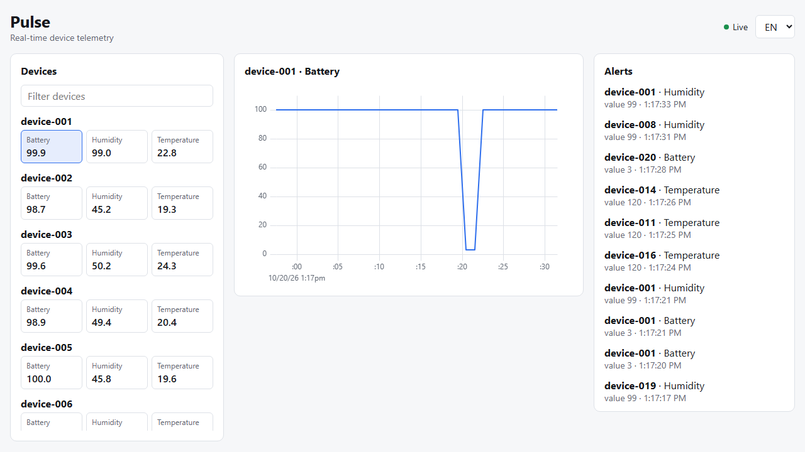
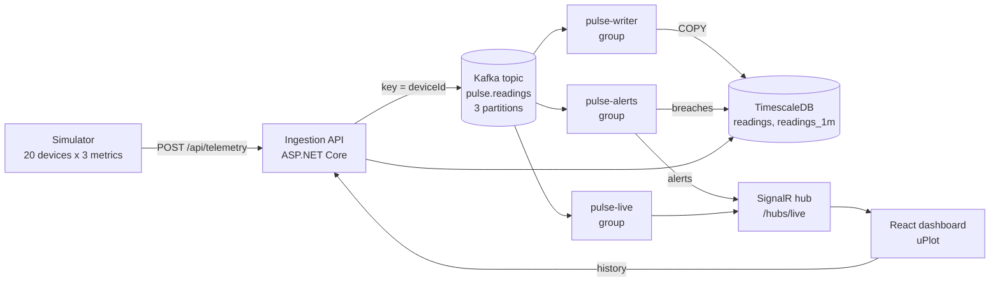

# Pulse

Real-time device telemetry platform. A simulator emits readings, an ingestion API publishes them to Kafka, independent stream processors persist them to TimescaleDB, evaluate alert rules and push live updates to a React dashboard over SignalR.



## What it demonstrates

- **Event streaming:** Kafka (Redpanda) topic keyed by device id, so one device always maps to one partition and keeps its ordering.
- **Consumer groups:** three independent groups (`pulse-writer`, `pulse-live`, `pulse-alerts`) read the same topic. Offsets are committed after a batch is handled (at-least-once delivery), batches are written with binary `COPY`.
- **Time-series modelling:** TimescaleDB hypertable, a 1-minute continuous aggregate, a 7-day retention policy on raw data. Short chart windows read raw rows, longer ones read the aggregate.
- **Real-time push:** SignalR hub with a throttled client store (state lives in refs and is published to React at most every 250 ms).
- **i18n:** `en` (default) and `uk`, react-i18next with browser language detection.
- **Tests:** xUnit for the alert rules, Playwright E2E for the dashboard in both locales.

## Architecture



The processors run as `BackgroundService`s inside the API process to keep the demo small. Because each is its own consumer group, any of them can be moved into a separate service without touching the others (see [ADR 0001](docs/adr/0001-kafka-consumer-groups-in-process.md)).

## Run it

Requirements: Docker. Everything runs locally.

```bash
docker compose up --build
```

- Dashboard: http://localhost:8080
- API: http://localhost:5080 (`GET /health`, `GET /api/devices`, `GET /api/alerts`, `GET /api/devices/{id}/series?metric=temperature&minutes=5`, `POST /api/telemetry`)

### Development

```bash
docker compose up -d redpanda timescaledb     # infrastructure only
dotnet run --project src/Pulse.Api --urls http://localhost:5080
dotnet run --project src/Pulse.Simulator
cd web && npm install && npm run dev          # http://localhost:5173
```

The schema script only runs on an empty database volume. After pulling schema changes, reset it with `docker compose down -v`.

### Tests

```bash
dotnet test                                    # unit tests plus PulseDb tests against a TimescaleDB Testcontainer (needs Docker)
cd web && npx playwright install chromium     # once
cd web && npx playwright test                  # E2E, needs the stack running (PULSE_WEB_URL overrides the URL)
```

## Configuration

| Setting | Default | Notes |
| --- | --- | --- |
| `Kafka:BootstrapServers` | `localhost:19092` | `redpanda:9092` inside compose |
| `ConnectionStrings:Timescale` | `localhost:5433` | |
| `Alerts:Rules` | temperature `[-10, 80]`, humidity `[5, 95]`, battery `>= 10` | threshold rules, see `AlertRulesOptions` |
| `Simulator:Devices` / `IntervalMs` / `AnomalyChance` | 20 / 1000 / 0.01 | the simulator injects out-of-range spikes on purpose |
| `OTEL_EXPORTER_OTLP_ENDPOINT` | unset | when set, traces and metrics are exported over OTLP |

## Trade-offs

- Processors share the API process. Simple to run, but a slow consumer competes with request handling for CPU. Splitting them out is a hosting change, not a design change.
- Alerts are evaluated per reading with no state, so a device stuck out of range raises an alert on every reading. Debouncing or hysteresis is the next step.
- Delivery is at-least-once, so a batch can be redelivered. Writes are idempotent: a reading is identified by `(device_id, metric, ts)` and alerts by `(device_id, metric, rule, ts)`, both enforced by unique indexes and `ON CONFLICT DO NOTHING`. The catch is that two genuinely different values for the same device, metric and timestamp collapse into the first one. Live SignalR pushes are not deduplicated, so a redelivery can briefly repeat a point in an open browser.
- Authentication is out of scope for this demo.

## Layout

```
src/Pulse.Api         ingestion, stream processors, SignalR hub, query endpoints
src/Pulse.Core        shared contracts and alert rules
src/Pulse.Simulator   device simulator
tests/Pulse.Tests     unit tests
web/                  React + TypeScript dashboard, Playwright E2E
db/init               TimescaleDB schema
docs/adr              architecture decision records
```
