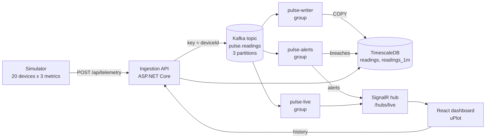
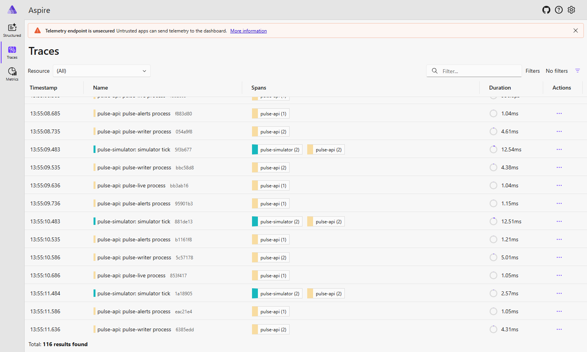
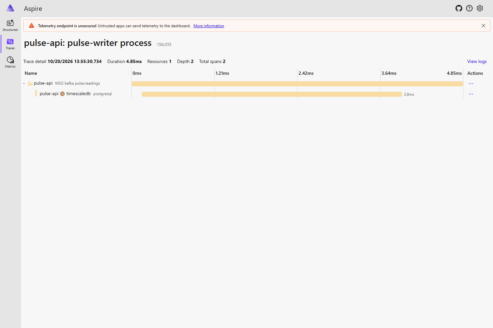

# Pulse

[](https://github.com/sskobalskyi/pulse/actions/workflows/ci.yml)

Real-time device telemetry platform. A simulator emits readings, an ingestion API publishes them to Kafka, independent stream processors persist them to TimescaleDB, evaluate alert rules and push live updates to a React dashboard over SignalR.


## What it demonstrates

- **Event streaming:** Kafka (Redpanda) topic keyed by device id, so one device always maps to one partition and keeps its ordering.
- **Consumer groups:** three independent groups (`pulse-writer`, `pulse-live`, `pulse-alerts`) read the same topic. Offsets are committed after a batch is handled (at-least-once delivery), batches are written with one idempotent `INSERT ... ON CONFLICT DO NOTHING`.
- **Alerting with hysteresis:** threshold rules have a margin. A breach raises one alert, and a second "resolved" alert is recorded only when the value comes back past the margin, so a value hovering around a threshold does not flap. State is rebuilt from the database on restart.
- **No-data alerts:** a sensor that stops reporting raises a "no data for 60s" alert and resolves it when data resumes. A silent device sends nothing, so no Kafka consumer can notice it. The writer upserts `device_last_seen` (by server receive time) and a `SilenceMonitor` polls it on a timer.
- **Time-series modelling:** TimescaleDB hypertable, a 1-minute continuous aggregate, a 7-day retention policy on raw data. Short chart windows read raw rows, longer ones read the aggregate.
- **Real-time push:** SignalR hub with a throttled client store (state lives in refs and is published to React at most every 250 ms).
- **Observability:** OpenTelemetry traces across HTTP and Kafka (context in message headers, span links for batches), metrics including per-partition consumer lag, and correlated logs. See [Observability](#observability).
- **i18n:** `en` (default) and `uk`, react-i18next with browser language detection.
- **Tests:** xUnit for the alert rules and tracker, Testcontainers tests for the database layer and for the whole backend pipeline (HTTP ingest, Kafka, stream processors, TimescaleDB and SignalR in one process against real containers), and Playwright E2E for the dashboard in both locales.

## Architecture



The processors run as `BackgroundService`s inside the API process to keep the demo small. Because each is its own consumer group, any of them can be moved into a separate service without touching the others (see [ADR 0001](docs/adr/0001-kafka-consumer-groups-in-process.md)).

## Run it

Requirements: Docker. Everything runs locally.

```bash
docker compose up --build
```

- Dashboard: http://localhost:8080
- API: http://localhost:5080 (`GET /health`, `GET /api/devices`, `GET /api/alerts`, `GET /api/devices/{id}/series?metric=temperature&minutes=5`, `POST /api/telemetry`)

### Development

```bash
docker compose up -d redpanda timescaledb     # infrastructure only
dotnet run --project src/Pulse.Api --urls http://localhost:5080
dotnet run --project src/Pulse.Simulator
cd web && npm install && npm run dev          # http://localhost:5173
```

The schema script only runs on an empty database volume. After pulling schema changes, reset it with `docker compose down -v`.

### Tests

```bash
dotnet test                                    # unit, database and pipeline tests (the last two need Docker)
cd web && npx playwright install chromium     # once
cd web && npx playwright test                  # E2E, needs the stack running (PULSE_WEB_URL overrides the URL)
```

## Observability

The API and the simulator are instrumented with OpenTelemetry and export over OTLP when `OTEL_EXPORTER_OTLP_ENDPOINT` is set. To look at it, start the stack with the extra compose file, which adds the .NET Aspire Dashboard:

```bash
docker compose -f docker-compose.yml -f docker-compose.observability.yml up --build
```

Dashboard: http://localhost:18888 (no login, local use only, telemetry is kept in memory).



**Traces.** Every simulator tick is a trace that continues into the API (`pulse.readings publish`). The trace context travels in the Kafka message headers (`traceparent`). A consumer batch mixes messages from many requests, so each batch is its own trace (`pulse-writer process`, `pulse-live process`, `pulse-alerts process`) with span links back to the producer spans (capped at 10 per batch). Npgsql adds the database spans underneath.



**Metrics** (meter `Pulse`, plus ASP.NET Core, Kestrel, Npgsql and .NET runtime):

| Metric | Meaning |
| --- | --- |
| `pulse.readings.ingested` | readings accepted and published to Kafka |
| `pulse.ingest.rejected` | rejected batches, tagged by reason |
| `pulse.consumer.batch.size` / `.duration` | per consumer group, duration also by outcome |
| `pulse.consumer.failures` | batches that failed and will be redelivered |
| `pulse.consumer.lag` | messages behind the end of each partition, per group and partition |
| `pulse.alerts` | alert state changes, by state and metric |
| `pulse.signalr.connections` | browsers connected to the live hub |
| `pulse.simulator.readings.sent` / `.send.failures` | simulator side |

**Logs** go through the same exporter, so each log line carries the trace id of the span it was written in.

The Aspire Dashboard is a viewer for local development. A full Grafana, Prometheus and Tempo stack is out of scope here.

## Configuration

| Setting | Default | Notes |
| --- | --- | --- |
| `Kafka:BootstrapServers` | `localhost:19092` | `redpanda:9092` inside compose |
| `ConnectionStrings:Timescale` | `localhost:5433` | |
| `Alerts:Rules` | temperature `[-10, 80]` ±2, humidity `[5, 95]` ±3, battery `>= 10` ±5 | threshold rules with a hysteresis margin, see `AlertRulesOptions` |
| `Simulator:Devices` / `IntervalMs` | 20 / 1000 | |
| `Alerts:NoData:Timeout` / `CheckInterval` / `Enabled` | `00:01:00` / `00:00:10` / `true` | how long a series may stay silent, how often the monitor looks (detection is late by up to this much), and an off switch |
| `Simulator:AnomalyChance` / `AnomalyMinTicks` / `AnomalyMaxTicks` | 0.002 / 5 / 15 | chance per reading that a device starts a fault, and how many readings the fault lasts |
| `Simulator:DropoutChance` / `DropoutMinTicks` / `DropoutMaxTicks` | 0.0002 / 90 / 150 | chance per reading that a sensor goes quiet, and for how many ticks (longer than the no-data timeout, so it is noticed) |
| `OTEL_EXPORTER_OTLP_ENDPOINT` | unset | when set, traces, metrics and logs are exported over OTLP |

## Trade-offs

- Processors share the API process. Simple to run, but a slow consumer competes with request handling for CPU. Splitting them out is a hosting change, not a design change.
- Alert state (raised or not) per device, metric and rule is kept in memory by one `AlertTracker` per instance. A batch only advances it after its alerts are stored, so a failed write is evaluated again on redelivery. On startup the state is rebuilt from the latest alert of each key in the database. With several API instances, partitions moving between them can still repeat a "raised" alert once, because each instance only knows what it saw or what was stored when it started. A threshold alert that is raised when a device goes silent stays raised until the device reports again, and a "no data" alert is raised next to it.
- The no-data monitor runs in every API instance. With several instances each one would raise its own alert, because the timestamps differ and the unique index cannot catch it. A single instance is fine, and the fix is a leader lock (for example a Postgres advisory lock per check), not done here.
- Silence is tracked per (device, metric), and a device that is decommissioned stays silent forever: there is no way to retire a device yet.
- Delivery is at-least-once, so a batch can be redelivered. Writes are idempotent: a reading is identified by `(device_id, metric, ts)` and alerts by `(device_id, metric, rule, ts, state)`, both enforced by unique indexes and `ON CONFLICT DO NOTHING`. The catch is that two genuinely different values for the same device, metric and timestamp collapse into the first one. Live SignalR pushes are not deduplicated, so a redelivery can briefly repeat a point in an open browser.
- Authentication is out of scope for this demo.

## Layout

```
src/Pulse.Api         ingestion, stream processors, SignalR hub, query endpoints
src/Pulse.Core        shared contracts and alert rules
src/Pulse.Simulator   device simulator
tests/Pulse.Tests     unit tests
web/                  React + TypeScript dashboard, Playwright E2E
db/init               TimescaleDB schema
docs/adr              architecture decision records
```
